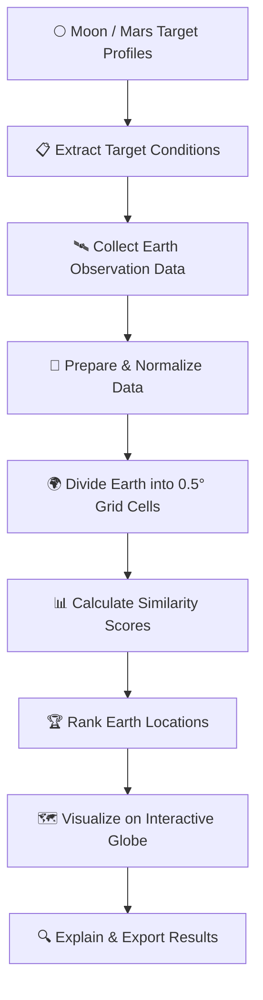

 <div align="center">


# 🌍 TerraNova

### Finding Earth Locations That Resemble the Moon and Mars

[](https://www.spaceappschallenge.org/)
[](https://python.org)
[](https://fastapi.tiangolo.com)
[](https://developer.mozilla.org/en-US/docs/Web/JavaScript)
[](https://threejs.org)
[](https://earthdata.nasa.gov)

<br/>

**78,247 Earth land cells. Multiple planetary targets. One global discovery platform.**

*Bringing planetary science and Earth observation together.*

</div>

---

## 📖 Overview

**TerraNova** is a planetary analogue discovery platform that identifies locations on Earth with environmental and terrain characteristics similar to selected locations on the Moon and Mars.

Space agencies need to understand how extraterrestrial environments may affect future exploration missions. However, studying these environments directly is difficult and expensive.

TerraNova addresses this challenge by comparing planetary target conditions with real Earth observation data and ranking locations according to their similarity.

### 🌎 What does TerraNova do?

- 🛰️ **Analyzes Earth Data** — Uses NASA and partner satellite datasets.
- 🌕 **Compares Moon Locations** — Evaluates Earth locations against selected lunar sites.
- 🔴 **Compares Mars Locations** — Finds potential Earth analogues for Martian environments.
- 📊 **Ranks Similar Locations** — Calculates similarity scores using measurable criteria.
- 🌐 **Visualizes the Planet** — Displays results on an interactive 3D globe and flat map.
- 🔍 **Explains Results** — Shows which environmental conditions influence each ranking.

> **Our goal:** Make planetary analogue discovery more accessible, explainable, and data-driven.

---

## ✨ Key Features

<table>
<tr>
<td width="50%">

### 🌍 Interactive 3D Earth Globe

Explore Earth through an interactive globe.

- Global location visualization
- Similarity score layers
- Environmental predictor layers
- Interactive location selection

</td>
<td width="50%">

### 🌕 Moon & Mars Target Profiles

Compare Earth with selected planetary locations.

- Shackleton Rim
- Malapert Massif
- Haworth Cold Trap
- Jezero Crater
- Gale Crater
- Custom target profiles

</td>
</tr>
<tr>
<td width="50%">

### 📊 Scientific Similarity Scoring

A deterministic mathematical scoring engine evaluates how closely Earth locations match planetary target conditions.

- Weighted criteria
- Normalized measurements
- Similarity ranking
- Explainable results

</td>
<td width="50%">

### 🗺️ God's Eye 3D Terrain Explorer

Explore selected locations at a more detailed scale.

- Local elevation models
- Terrain slope and relief
- 3D terrain visualization
- Optional satellite imagery
- Rover trafficability metrics

</td>
</tr>
<tr>
<td width="50%">

### 🔬 Explainable Analysis

Understand why a location receives a particular score.

- Criterion-level similarity
- Weight contribution
- Data source information
- Location-specific explanations

</td>
<td width="50%">

### 📥 Data Export & Validation

Work with results outside the platform.

- CSV export
- GeoJSON export
- Validation against known analogues
- Robustness testing
- Leave-one-criterion-out analysis

</td>
</tr>
</table>

---

## 🛰️ How TerraNova Works

TerraNova follows a data-driven workflow to identify potential Earth analogues.

<div align="center">



</div>

### Step-by-step explanation

| Step | Process | What happens? |
|---|---|---|
| 1 | Target Selection | Select a Moon or Mars location |
| 2 | Target Signature | Extract its measurable environmental conditions |
| 3 | Data Collection | Gather Earth observation datasets |
| 4 | Data Processing | Clean, normalize, and prepare the data |
| 5 | Global Grid | Analyze 78,247 land cells at 0.5° resolution |
| 6 | Similarity Scoring | Compare each Earth cell against the target |
| 7 | Ranking | Rank locations according to similarity |
| 8 | Visualization | Display results on the globe and map |
| 9 | Exploration | Inspect, explain, and export promising locations |

---

## 🏗️ System Architecture

<div align="center">

```text
                 🌍 TERRANOVA PLATFORM
                           │
             ┌─────────────┴─────────────┐
             │                           │
       FRONTEND APPLICATION         BACKEND API
             │                           │
       JavaScript / Three.js          FastAPI
             │                           │
     ┌───────┼────────┐          ┌───────┼────────┐
     │       │        │          │       │        │
   Globe   Map    Dashboard    Scoring  Data   Explainability
     │       │        │        Engine  API       Engine
     │       │        │          │       │        │
     └───────┴────────┘          └───────┼────────┘
                                         │
                               DATA PROCESSING LAYER
                                         │
                         ┌───────────────┼──────────────┐
                         │               │              │
                      NASA POWER     NASA GIBS      Terrain Data
                         │               │              │
                         └───────────────┼──────────────┘
                                         │
                                  EARTH GRID DATA
                                         │
                                SIMILARITY RESULTS
                                         │
                              🌕 MOON / 🔴 MARS
```

</div>

### Main architectural components

| Component | Responsibility |
|---|---|
| Frontend | Interactive globe, map, controls, and visualization |
| FastAPI Backend | API endpoints and application coordination |
| Data Acquisition | Retrieves and prepares Earth observation datasets |
| Predictor Stack | Stores global environmental and terrain predictors |
| Scoring Engine | Calculates similarity between target and Earth cells |
| Explainability Engine | Describes criterion-level results |
| God's Eye | Provides detailed local 3D terrain exploration |

---

## 🧮 Scientific Scoring Methodology

TerraNova uses a deterministic mathematical approach rather than relying on an AI model to decide which locations are similar.

### 1. Individual Criterion Similarity

For each environmental criterion, the system calculates how close an Earth measurement is to the target value.

\[
s_k(x)=\operatorname{clip}\left(
1-\frac{|x_k-t'_k|}{hi_k-lo_k},0,1
\right)
\]

Where:

- \(x_k\): Earth measurement for criterion \(k\)
- \(t'_k\): Normalized planetary target value
- \(hi_k\): Upper Earth reference limit
- \(lo_k\): Lower Earth reference limit
- \(s_k(x)\): Similarity score between 0 and 1

### 2. Weighted Overall Similarity

The individual similarities are combined using a weighted geometric mean.

\[
Score(x)=
\prod_k s_k(x)^{\frac{w_k}{\sum_j w_j}}
\]

Where \(w_k\) represents the importance of each criterion.

**Important:** If an active criterion has zero similarity, the overall score becomes zero. This makes major mismatches visible rather than hiding them behind high scores in other criteria.

---

## 🌡️ Environmental & Terrain Criteria

TerraNova compares Earth locations using measurable environmental and terrain characteristics.

| Criterion | What does it measure? |
|---|---|
| 🌧️ Precipitation | Amount of rainfall |
| 🌱 NDVI | Vegetation density |
| 🌡️ Temperature Range | Annual temperature variation |
| ☀️ Land Surface Temperature | Day and night surface temperature difference |
| ⛰️ Elevation | Height above sea level |
| 📐 Slope | Steepness of terrain |
| 🏔️ Roughness | Variation in terrain elevation |
| 🌡️ Mean Annual Temperature | Average yearly temperature |

Each criterion can be assigned a different weight depending on the selected planetary target.

---

## 🛰️ Data Sources

TerraNova uses Earth observation and planetary science datasets from established scientific sources.

| Data Source | Application |
|---|---|
| [NASA POWER](https://power.larc.nasa.gov/) | Precipitation and temperature data |
| [NASA GIBS](https://www.earthdata.nasa.gov/data/tools/gibs) | MODIS vegetation / NDVI data |
| [NASA LP DAAC](https://lpdaac.usgs.gov/) | MODIS land surface temperature |
| [AWS Terrain Tiles](https://registry.opendata.aws/terrain-tiles/) | Elevation and terrain data |
| [Natural Earth](https://www.naturalearthdata.com/) | Land masks and geographic boundaries |
| [NASA LRO](https://science.nasa.gov/mission/lro/) | Lunar target information |
| [NASA MOLA](https://pds-geosciences.wustl.edu/missions/mgs/megdr.html) | Mars elevation information |
| [Sentinel-2](https://dataspace.copernicus.eu/) | Optional high-resolution local imagery |

---

## 🌐 Interactive Visualization

TerraNova provides two main ways to explore results:

### 🌍 Global Earth Explorer

Explore global similarity results using the interactive globe and map.

**Suggested screenshot:** `assets/screenshots/global-globe.png`

### 🗺️ God's Eye — Local Terrain Explorer

Explore a selected location using detailed terrain visualization and local elevation information.

**Suggested screenshot:** `assets/screenshots/gods-eye.png`

### 📊 Similarity Analysis

Inspect ranked locations, criterion-level explanations, and validation results.

**Suggested screenshot:** `assets/screenshots/analysis-dashboard.png`

> Replace these screenshot paths with actual screenshots from your running application.

---

## 🛠️ Technology Stack

<table>
<tr>
<th>Layer</th>
<th>Technology</th>
</tr>
<tr>
<td><b>Backend</b></td>
<td>


</td>
</tr>
<tr>
<td><b>Frontend</b></td>
<td>


</td>
</tr>
<tr>
<td><b>Geospatial & Scientific Processing</b></td>
<td>


</td>
</tr>
<tr>
<td><b>Satellite & Planetary Data</b></td>
<td>


</td>
</tr>
<tr>
<td><b>Development Tools</b></td>
<td>


</td>
</tr>
</table>

---

## 📂 Project Structure

```text
TerraNova/
│
├── data/
│   ├── targets.json
│   └── normalization.json
│
├── src/
│   ├── acquire/
│   │   ├── calibrate.py
│   │   ├── build_predictor_stack.py
│   │   ├── power.py
│   │   ├── gibs_ndvi.py
│   │   └── landmask.py
│   │
│   ├── compute/
│   │   └── terrain.py
│   │
│   └── api/
│       └── main.py
│
├── web/
│   ├── app.js
│   ├── globe.js
│   └── ...
│
├── cache/
├── requirements.txt
└── README.md
```

---

## 🚀 Getting Started

### Prerequisites

Make sure you have installed:

- Python 3.10 or later
- Git
- A modern web browser

### 1. Clone the Repository

```bash
git clone https://github.com/Yakiyo/terra-nova.git
cd terra-nova
```

### 2. Create a Virtual Environment

```bash
python -m venv .venv
```

Activate it:

**Windows PowerShell**

```powershell
.venv\Scripts\Activate.ps1
```

**Linux / macOS**

```bash
source .venv/bin/activate
```

### 3. Install Dependencies

```bash
pip install -r requirements.txt
```

### 4. Build the Predictor Stack

```bash
python -m src.acquire.build_predictor_stack
```

This prepares the global predictor dataset used by the scoring engine.

### 5. Start the Backend

```bash
uvicorn src.api.main:app --reload
```

### 6. Open the Application

| Service | URL |
|---|---|
| Application | http://127.0.0.1:8000/ |
| API Documentation | http://127.0.0.1:8000/docs |
| Health Check | http://127.0.0.1:8000/api/health |

*Note: These commands follow the project's current documented structure. Check the repository's latest setup instructions and required data downloads before running them.*

---

## 🔬 Validation & Reliability

TerraNova includes validation and robustness tools to examine how reliable the similarity rankings are.

- **ROC-AUC validation:** Evaluates separation between catalogued analogues and negative controls.
- **Leave-one-criterion-out:** Checks how results change when a criterion is removed.
- **Robustness testing:** Tests score stability under controlled perturbations.
- **Explainability:** Shows how individual criteria contribute to the final result.

The repository reports an AUC of 1.00 on its built-in validation dataset. This result applies to that dataset and validation setup; it does not establish universal accuracy or prove that every newly ranked location is a suitable mission site.

---

## ⚠️ Limitations

TerraNova is a scientific screening tool, not a replacement for detailed field surveys or planetary mission engineering.

- The global analysis uses 0.5° grid cells, which average local terrain conditions.
- Some datasets have spatial gaps, particularly in polar regions.
- Earth cannot reproduce lunar vacuum or permanently shadowed region temperatures.
- Novelty labels depend on the available known-analogue catalogue.
- Similarity scores indicate resemblance across selected criteria, not complete environmental equivalence.

---

## 🛣️ Future Improvements

- [ ] Add more planetary target profiles.
- [ ] Improve high-latitude and polar data coverage.
- [ ] Integrate additional high-resolution terrain datasets.
- [ ] Expand local terrain and rover mobility analysis.
- [ ] Add more planetary environmental criteria.
- [ ] Improve validation with additional independent analogue datasets.
- [ ] Add richer comparison and reporting tools.

---

## 👥 Meet the Team

<div align="center">

### 🚀 Team TerraNova

| Team Member | Role |
|:---:|:---:|
|  | **Hafiz Muhammad Anas** |
| **Team Lead** | Project coordination & leadership |
|  | **Adeeb Ur Rehman** |
| **Developer** | Software development |
|  | **Shayan Baig** |
| **Demotivator** | Team role |
|  | **Aimen Ismail** |
| **Presenter** | Project communication |
|  | **Syeda Sheza** |
| **Presenter** | Project communication |

</div>

---

## 🤝 Contributing

Contributions, suggestions, and improvements are welcome.

1. Fork the repository.
2. Create a feature branch.
3. Make your changes.
4. Commit your changes.
5. Submit a Pull Request.

---

## 📄 License

Please refer to the repository's `LICENSE` file for licensing information.

---

<div align="center">


### 🌍 Exploring Earth. Understanding Other Worlds.

**Built with science, satellite data, and curiosity by Team TerraNova.**

*NASA Space Apps Challenge 2026*

</div>
